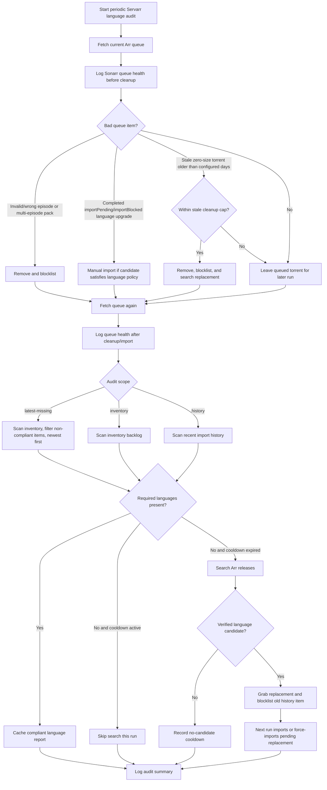

# Sonarr/Radarr Integration

`direct-play-nice` can be wired as a custom script in Sonarr/Radarr pipelines.

## High-level flow

1. Arr service imports media.
2. Custom script invokes `direct_play_nice`.
3. Successful conversion output replaces source according to configured behavior.

## Hook setup and verification

In `Settings -> Connect -> Custom Script`, enable both `On Import` (called
`On Download` in some versions) and `On Upgrade`. The first subscription covers
initial imports; the second covers replacements. With only the first enabled,
Arr can replace a converted movie or episode with a large download without
invoking DPN again.

Check the saved notification in the UI or read `/api/v3/notification`: the DPN
Custom Script should have `onDownload=true` and `onUpgrade=true`. This is a
notification setting, not the quality profile's permission to download upgrades.
Keep quality-only upgrades conservative when DPN controls output quality;
otherwise Arr may repeatedly replace a smaller converted file with a higher
quality release.

Use a disposable test item to check the initial import and a subsequent upgrade.
The upgrade should invoke DPN with `*_eventtype=Download` and `*_isupgrade=True`.
After a successful conversion, check that the final output is playable, the
replaced library original and `.direct-play-nice.bak` are gone, and Arr recognizes
the output after scanning. A failed conversion must leave the source available.
The custom script's `Test` button only checks the non-converting Test event; it
does not prove that upgrade notifications are enabled.

Enabling the hook is not retroactive. Existing unconverted media needs a
separate, deliberate conversion pass. Language audits are not a general
compression pass either. Do not delete an existing remux just because another
movie has a `.fixed.mp4`: verify a successful replacement for that exact file.
Servarr finalization replaces the imported library file; it does not recursively
delete the download client's staging or seeding directories.

## Event behavior

The binary auto-detects Sonarr/Radarr custom-script invocations:

- `sonarr_eventtype=Download` and `radarr_eventtype=Download` trigger conversion.
- Upgrades use the same `Download` event, with `sonarr_isupgrade=True` or
  `radarr_isupgrade=True`; there is no separate `Upgrade` event to configure
  in DPN.
- Non-download events (for example `Test`, `Grab`, `Rename`) exit cleanly.

## Naming and replacement notes

- DPN picks the replacement's container before naming the file. It keeps the
  source container when every selected device can play it, and otherwise uses a
  container all of them support (`mp4` for `--device all`).
- Use `--servarr-output-suffix` to control output naming.
- `--servarr-output-extension` (deprecated) forces a container: `mp4`, `m4v`,
  `mov`, `mkv`, or `match-input` to keep the source container. The forced
  container must be playable on every selected device.
- `--delete-source` applies to direct CLI usage.

### Replacement policy

For each imported file DPN resolves three paths from the original
(`<input>` below is the full original filename, `<final>` the resolved
output name):

| Path | Purpose |
| --- | --- |
| `<final>.direct-play-nice.tmp.<ext>` | Where the transcode writes. Created next to the final path. |
| `<input>.direct-play-nice.bak.<ext>` | Where the original is parked during promotion. |
| `<final>` | The file Sonarr/Radarr ends up with. |

The sequence on success is: transcode into the temporary file, validate it,
rename the original to the backup path, rename the temporary file to the final
path, delete the backup. Both renames stay on the same filesystem, so the final
path never holds a partial file. Direct CLI conversion stages through the same
`.direct-play-nice.tmp` file and promotes it by rename; only the backup step is
Servarr-specific.

On a transcode or validation failure the temporary file is removed and the
original is left where it was. If the process is killed mid-transcode the
original is untouched and the temporary file is left behind for you to delete.
If the process dies between the two renames, the original is still complete
under the `.bak` name; rename it back by hand.

Already-compatible inputs produce no output and are left in place.

### Dry run

`--dry-run` (or `dry_run = true` in the config file) prints the plan for each
file in the event and exits before any write, rename, or delete. It is the
quickest way to confirm the resolved paths on a new install:

```bash
sonarr_eventtype=Download sonarr_episodefile_path=/tv/Show/S01E01.mkv \
  /path/to/direct_play_nice --config-file /path/to/direct-play-nice-sonarr.toml --dry-run
```

```text
Dry run: no file will be written, renamed, or deleted.
  Mode:            Sonarr Download event
  Input:           /tv/Show/S01E01.mkv
  Action:          transcode
                   - video codec hevc is not compatible with required H.264
  Output:          /tv/Show/S01E01.fixed.mp4
  Temp output:     /tv/Show/S01E01.fixed.direct-play-nice.tmp.mp4
  Backup:          /tv/Show/S01E01.direct-play-nice.bak.mkv
  Source:          moved to the backup path, then removed once the output is promoted
  ...
```

`--dry-run` also forces `servarr_language_dry_run` on and stops DPN from
updating its language cache, so a dry run of a language-checked import or a
`--servarr-language-audit` pass grabs nothing, blocklists nothing, and writes
nothing. `--output json` switches the report to JSON.

Example command in Sonarr custom script:

```bash
/path/to/direct_play_nice --config-file /path/to/direct-play-nice-sonarr.toml
```

## Optional language mismatch replacement

A Sonarr/Radarr `Download` event cannot use explicit CLI input and output paths
when language checking is enabled. Remove both paths and let DPN resolve them
from the event. When language checking is disabled, explicit paths retain direct
CLI behavior.

Language checks are off by default. When enabled on a Sonarr/Radarr `Download`
event, `direct-play-nice` inspects the imported file before conversion. If any
configured audio or subtitle language is missing, conversion is skipped and DPN
asks Sonarr/Radarr for manual-search release results. It only grabs a specific
replacement release when the returned release metadata or configured candidate
policy indicates the required languages. Existing-file/cutoff rejections may be
overridden for language upgrades, but unrelated rejection reasons are still
honored. If no verified candidate is available, DPN leaves the current file
untouched and does not request a blind redownload.

### CLI examples

Dry-run first while tuning your matching rules. This inspects the imported file,
queries Arr for replacement candidates when requirements are missing, and reports
what would happen without grabbing or blocklisting anything:

```bash
/path/to/direct_play_nice \
  --servarr-language-check \
  --servarr-language-dry-run \
  --servarr-language-candidate-policy custom-format-or-title \
  --required-audio-languages eng \
  --servarr-api-url http://127.0.0.1:8989 \
  --servarr-api-key "$SONARR_API_KEY"
```

After dry-run output looks correct, remove `--servarr-language-dry-run` to allow
DPN to grab the selected replacement and blocklist the old history item:

```bash
/path/to/direct_play_nice \
  --servarr-language-check \
  --servarr-language-candidate-policy custom-format-or-title \
  --required-audio-languages eng \
  --servarr-api-url http://127.0.0.1:8989 \
  --servarr-api-key "$SONARR_API_KEY"
```

### Config-file example

In a Sonarr/Radarr custom script, prefer keeping the command short and putting
policy in the DPN config file:

```bash
/path/to/direct_play_nice --config-file /path/to/direct-play-nice-sonarr.toml
```

```toml
servarr_language_check = true
servarr_language_audit = true
servarr_language_audit_scope = "history"
servarr_language_audit_lookback_days = 30
servarr_language_audit_max_searches = 20
# Optional: prevent persistent no-candidate items from consuming every audit run.
servarr_language_audit_no_candidate_cooldown_days = 14
# Optional: limit a Sonarr audit to specific episode IDs.
# servarr_language_audit_episode_ids = "123,456"
required_audio_languages = "eng"
# Leave empty unless subtitle completeness is a goal.
required_subtitle_languages = ""
# Optional: for trusted English-native libraries, retag untagged audio before
# deciding the file is missing English audio.
servarr_untagged_audio_language = "eng"
servarr_api_url = "http://127.0.0.1:8989"
servarr_api_key = "..."

# Recommended while tuning rules. Logs the selected candidate but does not grab
# or blocklist anything. The global dry_run below implies this setting.
servarr_language_dry_run = true

# Optional: print the full replacement plan and exit without writing anything.
# Useful on a first run against a real library; remove once the paths look right.
# dry_run = true

# strict only trusts explicit Arr language/subtitle metadata. custom-format-or-title
# also trusts matching custom formats and strong tokens like Dual-Audio/Multi-Subs.
servarr_language_candidate_policy = "custom-format-or-title"
```

For Radarr, use the Radarr URL/key instead:

```toml
servarr_api_url = "http://127.0.0.1:7878"
servarr_api_key = "..."
```

`servarr_api_url` and `servarr_api_key` can also be supplied with CLI flags or
environment variables. Supported env names include `SONARR_URL`,
`SONARR_API_KEY`, `RADARR_URL`, and `RADARR_API_KEY`.

To keep a verified recovery copy before DPN requests a language replacement,
set `servarr_language_recovery_root` to an existing private directory outside
all managed libraries. DPN copies the current media and recognized sidecars,
records hashes and file metadata, and retains the copy for manual recovery.
It does not automatically restore a file if Arr replaces it. The recovery root
must have sufficient space; DPN enforces built-in safety limits and does
not automatically delete old backups.

After grabbing a verified replacement, DPN marks the current download failed in
Arr history so the old release is blocklisted. It resolves that history item
from the Arr download id when available, or from
`DIRECT_PLAY_NICE_SONARR_HISTORY_ID` / `DIRECT_PLAY_NICE_RADARR_HISTORY_ID` if
your wrapper provides it, and marks the download's `grabbed` record failed: Arr
cannot blocklist a release from its import record.

Candidates whose title is already on the item's Arr blocklist are skipped, since
Arr matches its blocklist per indexer and would otherwise grab the same release
from another indexer. Candidates that are the release behind the current file,
identified from its Arr history and scene name, are skipped as well. DPN records
an intent before requesting a grab. If the request fails or its outcome is
uncertain, DPN retains that intent for review rather than automatically trying
another candidate.

Release titles do not always list every audio track, so the audit checks its own
grabs after Arr imports them. Each grab is remembered in DPN's cache next to the
no-candidate cooldown. At the start of every audit run, DPN looks for the import
of each remembered grab in Arr history and assesses the imported file against
the languages the grab was meant to provide. If a required language is still
missing, DPN marks that release's `grabbed` history record failed so Arr
blocklists it, clears the item's no-candidate cooldown, and the same run
can search the item again. If DPN cannot establish the imported file's identity
or inspect its streams, it retains the pending record for review instead of
assuming success or forgetting it. With `servarr_language_dry_run`, DPN only
reports what it would blocklist.

For Sonarr/Radarr, a language-better file can be stuck as a completed queue item
when Arr considers it a quality downgrade. Audit mode checks those pending
imports; when the pending file satisfies DPN's language policy, apply mode asks
Arr to perform a manual import and removes the completed queue item without
deleting the downloaded replacement. DPN must be able to inspect the exact
file submitted to Arr; release titles and custom formats are not a substitute.
Arr controls the replacement, so a failed or uncertain import does not guarantee
that the previous file remains in place.

The default examples above require English audio only. Extra audio languages are
allowed; a file with English plus Japanese audio still satisfies
`required_audio_languages = "eng"`. Use stricter audio requirements such as
`eng,jpn` only for libraries where preserving the original language alongside the
dub is required. Leave `required_subtitle_languages` empty if missing subtitles
are acceptable.

When language checking is enabled, DPN preserves original-language audio that it
finds in the current file before it initiates a replacement. This policy is on by
default. It does not require English unless English is configured or is the
original language already present. It does not search just because the original
track is absent. Configured audio and subtitle requirements still apply.

DPN checks the current file's tracks and Arr's original-language identity before
a replacement. If either is unavailable or conflicting, DPN leaves the item for
review. An already-compliant file does not need original-language metadata for
this policy. To opt out, set `servarr_keep_present_original_audio = false` or
pass `--servarr-keep-present-original-audio false`. Automatic release selection
requires explicit Arr language metadata for a present original track. That
metadata is not proof of the downloaded bytes. DPN probes files before it asks
Arr to import them, but Arr can import a download independently before that
check. Recovery copies are optional and are not restored automatically. Existing
pending records retain their historical requirements; records without preservation
evidence remain for review.

The default policy disables inference for untagged audio during language checks,
so an inferred tag cannot become evidence of a pre-existing original track.
Subtitle inference is independent. Opt out of the default policy if the library
relies on configured audio inference.

For a library with multiple languages, opt in to the stricter original-audio
policy with
`servarr_preserve_original_audio = true` or `--servarr-preserve-original-audio`.
The option is off by default. When language checking is enabled, DPN requires
English and the title's original language from Sonarr or Radarr, in addition to
the configured audio and subtitle requirements. Unknown or conflicting original
metadata prevents actions for that target. With this option, an automatic
replacement must include every required non-English audio language in its Arr
release metadata. A title or custom format alone cannot establish those
languages, so DPN may skip an available release when metadata is missing. English
may still use the hints allowed by the configured candidate policy. Release
metadata is not proof of the downloaded file's streams; DPN continues to check
the imported file against the stored requirements. Configure
`servarr_language_recovery_root` to retain a copy before a DPN-initiated
replacement. Arr can import independently before DPN checks the replacement;
the backup does not make that import atomic or automatically restore the file.
A hook cannot recover a file that Arr already replaced before the hook ran.

Existing pending records keep their historical requirements. When the option is
enabled, DPN retains a pending record for review if its snapshot lacks English or
the current original language, or if the original cannot be established. It does
not rewrite the snapshot to match today's policy.

With the option enabled, DPN uses inference for untagged audio only when the
configured language matches the title's identified original language and that
language is missing. Independent subtitle inference is unchanged. Untagged audio
is not itself evidence of a language.

Untagged streams are handled conservatively. By default, `und`/empty language
metadata does not satisfy a required language. If a library is known to be
English-native and the default preservation policy is disabled, set
`servarr_untagged_audio_language = "eng"` or pass
`--servarr-untagged-audio-language eng` to remux unknown audio streams with an
English tag before DPN searches for replacement releases. The remux uses stream
copy, writes through a temporary file, and never overwrites an explicit
non-unknown language tag. `servarr_language_dry_run = true` only reports the
retag action. Use `servarr_untagged_subtitle_language` only for trusted subtitle
streams; DPN does not run speech recognition or globally infer `und = eng`.

Candidate policies control how much DPN infers before a replacement is grabbed:

- `strict`: only explicit Arr language/subtitle metadata.
- `custom-format`: explicit metadata plus matching Arr custom format names such
  as `Anime-multi-audio` or `anime-multi-sub`.
- `custom-format-or-title`: custom formats plus strong title tokens such as
  `Dual-Audio`, `Multi-Audio`, `Multi-Subs`, or `MSubs`.
- `title-guess`: looser title matching. Use dry-run first.

### Proof-backed Sonarr checks

With proof options on the command line, DPN checks one exact release against a
local file. The operator attests that the file corresponds to the release; the
initial grab does not verify the downloaded bytes before Sonarr imports them.
This feature is available only on Linux and requires a private recovery root.
It is a one-shot Sonarr audit: pass exactly one episode ID, set the search limit
to one, and supply both `--servarr-language-proof-title` and
`--servarr-language-proof-file`. Disable unknown-stream retagging for the run.
DPN limits the proof file, the downloaded file, and the later imported file to
2 GiB each. Each sealed snapshot uses shared memory roughly equal to the file
size, plus probe and system overhead. Check available memory and service or
container limits before running a proof check. Checks using different recovery
roots can run concurrently and consume memory at the same time.

If the current file has no identifiable release, the proof fallback requires a
verified missing audio or subtitle language. It also retains the history,
identity, sidecar, backup, and proof checks described below.

DPN takes a nonblocking lock on the recovery root before creating a snapshot.
Only one cooperating proof check can run at a time for that root. If the lock is
busy, retry later. A later audit must use the same recovery root to check the
pending import; otherwise, the pending record remains for review. Proof dry runs
also take this lock, but do not create a lock file or update scheduling state.

Only cooperating processes that use the same recovery root and a filesystem
with working advisory locks share this lock. Arr can still import a download;
the backup does not make the import atomic.
In proof mode, DPN keeps the previous backup and does not send Arr a failure for
the old release. Before it records a grab intent, DPN saves a checkpoint for the
published backup. A later audit checks that the manifest and every backup blob
still match that checkpoint. Records created before checkpoints were added remain
pending for manual review. The checkpoint detects changes to recovery evidence;
it does not authenticate evidence against someone who can also change the ledger.
Do not run an older DPN version against the same pending records: it may ignore
the checkpoint.

Checkpoint verification reads every backup blob. It accepts a manifest of at
most 64 MiB, one media file and up to 4,096 sidecars, with at most 512 GiB of
backup data in total. The checkpoint verifier uses no-follow filesystem operations
on Linux and macOS and fails closed on other platforms. Proof-backed audits
still require Linux. An imported file with a different hash remains pending for
operator review.

DPN always treats the already-imported file differently from candidate releases:
actual file compliance is based on FFmpeg stream metadata, then cached by DPN.
The best-effort cache defaults to
`$XDG_CACHE_HOME/direct-play-nice/servarr-language-cache.json` or
`~/.cache/direct-play-nice/servarr-language-cache.json`; override it with
`DIRECT_PLAY_NICE_LANGUAGE_CACHE`.

## Periodic language audit

The Download-event hook only runs when Arr imports a file. To catch delayed dubs
or subtitles that appear days later, run an audit from cron/systemd/launchd with
no Arr custom-script environment variables.

### Language upgrade process

The periodic audit is language-first. It treats queue remediation, delayed
dub/sub searches, and conservative torrent cleanup as separate stages so a bad
or blocked queue item does not permanently prevent a better language candidate
from importing.



Queue health is logged at the start of Sonarr audits and after cleanup/import
stages. The log includes total queue items, completed import-pending/import-blocked
items, stale zero-size torrents, queued nonzero torrents, active downloads, and
invalid/mismatch warning counts. Use those counters to distinguish genuine bad
queue entries from a saturated torrent client. For example, many old zero-size
queued torrents may indicate Deluge's active download queue is too small rather
than a bad release.

Run an audit with:

```bash
/path/to/direct_play_nice \
  --config-file /path/to/direct-play-nice-sonarr.toml \
  --servarr-language-audit \
  --servarr-language-audit-lookback-days 30 \
  --servarr-language-audit-max-searches 20 \
  --servarr-language-dry-run
```

By default, audit mode uses `--servarr-language-audit-scope history`: it queries
recent Sonarr/Radarr imports, inspects the actual imported file language
metadata, updates DPN's cache, and release-searches only missing-language items
up to `--servarr-language-audit-max-searches`. Use
`--servarr-language-audit-scope inventory` with Sonarr to inspect the current
library inventory instead of only recent import history. Inventory scope walks
series episode files, checks current media metadata, then uses each missing
item's latest import history entry before any apply-mode grab/blocklist action.
Use `--servarr-language-audit-scope latest-missing` to inspect inventory and keep
only files that lack required languages. Recent releases take priority, but DPN
rotates targets by their last attempt and reserves part of the budget for older
items. Future-dated releases are treated as backlog.

If early inventory items repeatedly return no approved replacement, set
`--servarr-language-audit-no-candidate-cooldown-days` (or
`servarr_language_audit_no_candidate_cooldown_days`) so those no-candidate items
are not release-searched again until the cooldown expires. For weekly delayed
sub/dub drops, use
`--servarr-language-audit-latest-missing-no-candidate-cooldown-days` (or
`servarr_language_audit_latest_missing_no_candidate_cooldown_days`) to give
`latest-missing` a shorter retry window than broad backlog sweeps. Each
consecutive no-candidate result for the same item doubles its cooldown (for
example 2, 4, 8, then 14 days) up to
`--servarr-language-audit-no-candidate-max-cooldown-days` (or
`servarr_language_audit_no_candidate_max_cooldown_days`, default `14`), so items
that never find a release stop costing an indexer search every few days. Set it
at or below the cooldown to keep a fixed retry window. DPN stores
this best-effort state in
`$XDG_CACHE_HOME/direct-play-nice/servarr-language-no-candidate-cache.json` or
`~/.cache/direct-play-nice/servarr-language-no-candidate-cache.json`; override it
with `DIRECT_PLAY_NICE_LANGUAGE_NO_CANDIDATE_CACHE`. This lets later inventory
items get searched on subsequent capped audit runs instead of reprocessing the
same no-candidate edge every day. A language dry run does not create or extend
these cooldowns.

For focused Sonarr batches, pass `--servarr-language-audit-episode-ids` with a
comma-separated episode ID list. Pending verification is limited to those IDs.
Queue cleanup also requires every identified episode in an item to be in the
list; items with missing or invalid episode identity are left untouched.

A normal Sonarr audit targeting exactly one episode can request a proof-backed
manual import. **DPN cannot verify that Sonarr sees the same file or output
folder as DPN.** Immediately before each action, independently compare both
identities in Sonarr's mount namespace and DPN's namespace. Only then provide an
operator attestation for that episode and queue item:

```text
DPN_SONARR_PROOF_IMPORT_FILESYSTEM_ATTESTATION=I_VERIFIED_SONARR_AND_DPN_FILE_AND_OUTPUT_FOLDER_IDENTITIES:<episode-id>:<queue-id>
```

Replace both placeholders with the exact decimal IDs. The value must match
exactly; missing, incorrect, or stale IDs stop the import. This is an operator
attestation, **not a filesystem check or an atomic guarantee**. Set it only for
the individual audit invocation, not in a persistent service environment. DPN
does not consume or expire the variable, so reusing it would reuse the
attestation without another verification.

The audit must use the original recovery root, the same language requirements,
and no unknown-stream retagging. Do not pass the one-shot proof options again.
DPN checks the original file and backup,
the queue and history identity, and a single matching manual item. The queue
status must be OK or a warning with recognized quality reasons. The manual item
must include a rejection list that is empty or contains only recognized quality
reasons. At least one recognized quality rejection must appear in the queue or
manual item. Missing or unrecognized rejection metadata stops the import. DPN
hashes and probes the downloaded file against the saved proof before posting
the import. An unresolved intent or a legacy proof without a checkpoint requires
review. DPN also checks that no other episode in Sonarr refers to the original
file. It compares the current subtitle sidecars with the checkpoint. A checkpoint
that predates sidecar identity recording needs review if it contains sidecars.

Before this import, set `DPN_SERVARR_PROOF_ADDITIONAL_ROOTS` to a JSON array of
absolute paths for **every other** managed library and recovery root. Include
roots managed by applications other than this Sonarr instance. Set it to `[]`
only if no such roots exist. DPN cannot discover those other roots itself; the
operator must keep the list complete. An unset, invalid, or inaccessible root
prevents the import.

A download may share an ext4 filesystem with a managed or recovery root if DPN
can establish that the paths are separate. DPN checks mount IDs, directory
identities, bind mounts and hardlinks. It rejects unresolved mappings and
same-device submounts under protected roots. Same-device xfs, btrfs and tmpfs
remain blocked. The checks require Linux `openat2`, `statx` mount IDs, and a
readable mount table; missing information requires manual review. Other types,
including network and overlay filesystems, also require manual review. The tracked
output path must be a real directory containing only the selected file directly;
nested directories, extra entries and uncertain cleanup scope fail closed.
The import path requests Sonarr's `copy` mode. Sonarr controls how it executes
that request.

A dry run performs the same read-only eligibility checks and requires the same
attestation, but does not reserve the target for a later apply. DPN keeps the
pending proof and backup until a later audit verifies the import. If the command
outcome or resulting file is uncertain, it also retains the import intent for
review. Once an import is confirmed, DPN durably binds its download ID to the
pending record before removing the intent.

Sonarr audits defer ordinary force-import and queue cleanup while any proof
pending record or intent remains. Entries may share a download or output folder,
so the code cannot safely attribute them from incomplete state. A cooperative
lock coordinates these actions only among DPN processes that use the same cache
and honor the lock; independent writers are not controlled.

Sonarr may import a download independently before these checks run. It or another
writer may also change the pathname after DPN checks it. The check and Sonarr's
import are not atomic.

DPN also checks completed pending imports that Sonarr/Radarr refused for quality
hierarchy reasons. When deciding whether to force-import a pending language
upgrade, DPN inspects the existing media file's actual stream metadata instead of
trusting Arr's language label. This lets a lower-quality pending file replace a
higher-quality current file only when the current file is missing a required
language and the pending file satisfies the language policy.

Sonarr auto-grabs are limited to releases that map back to the single requested
episode; multi-episode and season-pack results are skipped even when their titles
contain strong language hints. During audits, DPN can also clean up hopeless
queue entries: completed warning items with invalid season/episode or wrong
multi-episode mappings are removed and blocklisted, while quality-only warnings
are left for possible force-import. Set
`--servarr-language-audit-stale-queue-days` to also remove and blocklist
zero-size torrent queue items that have not acquired metadata after the given
number of days. Before removing a stale item, DPN checks the import history and
searches for a verified replacement. It keeps the item if any episode cannot be
checked safely. A pack that exceeds the available search budget must wait. You
can raise the budget or resolve it manually, but reserved audit capacity and
other items may still prevent cleanup. An item without import history also needs
manual attention or restored history. DPN reserves at least one search for the
selected audit scope when the budget is greater than one. With one search, it
uses prior attempts to alternate between cleanup and the audit when possible.
In apply mode, a stale item with no candidate waits five minutes before another
attempt.

DPN stores preflight attempts in `servarr-language-preflights.json` beside the
language cache. In apply mode, DPN holds a per-target lock while checking and
grabbing a replacement. After claiming a target, DPN checks the current queue
and cooldown again before searching. If DPN cannot claim a target because the cache cannot
be read or written, it skips the search and reports an error. A language dry run
reads scheduling state but does not update it, so repeated dry runs may show the
same targets. A process that exits unexpectedly can leave a claim that delays
another attempt for up to one hour. Do not remove lock files while an audit is
running. The locks only coordinate processes that share the same cache and a
filesystem that supports advisory locks. Other clients and separate caches can
still race. Arr state can change after removal, and DPN cannot restore an item
if a later recheck or grab fails.

Use `--servarr-language-audit-stale-queue-max-removals` to cap churn per run. Keep
dry-run enabled while reviewing reports; remove
`--servarr-language-dry-run` only when you want DPN to grab selected
language-upgrade candidates, blocklist the old history item, force-import
eligible pending replacements, and clean bad queue entries.

This feature assumes DPN is the authority for language upgrades. To avoid Arr
and DPN fighting each other, keep ordinary Arr quality-only upgrades conservative
or disabled for libraries where DPN should make language-first replacement
decisions.

## Safe language upgrade runbook

Language replacement is intentionally opt-in and should be rolled out in small,
observable batches. A safe operator workflow is:

1. **Start with a dry-run history audit.** This catches delayed dubs/subs for
   recent imports without scanning the whole library:

   ```bash
   /path/to/direct_play_nice \
     --config-file /path/to/direct-play-nice-sonarr.toml \
     --servarr-language-audit \
     --servarr-language-audit-scope history \
     --servarr-language-audit-lookback-days 30 \
     --servarr-language-audit-max-searches 20 \
     --servarr-language-dry-run
   ```

2. **Use `latest-missing` dry-run for delayed dub/sub follow-up.** This
   prioritizes recent non-compliant files while reserving a share for older items:

   ```bash
   /path/to/direct_play_nice \
     --config-file /path/to/direct-play-nice-sonarr.toml \
     --servarr-language-audit \
     --servarr-language-audit-scope latest-missing \
     --servarr-language-audit-max-searches 25 \
     --servarr-language-audit-latest-missing-no-candidate-cooldown-days 2 \
     --servarr-language-dry-run
   ```

3. **Use inventory dry-run for backlog discovery.** This can be slow on large
   libraries, so keep the search cap low while tuning:

   ```bash
   /path/to/direct_play_nice \
     --config-file /path/to/direct-play-nice-sonarr.toml \
     --servarr-language-audit \
     --servarr-language-audit-scope inventory \
     --servarr-language-audit-max-searches 25 \
     --servarr-language-dry-run
   ```

4. **Review candidate evidence before apply mode.** Prefer candidates with
   explicit Arr language metadata or strong custom-format/title evidence such as
   `Anime-multi-audio`, `anime-multi-sub`, `Dual-Audio`, `Multi-Audio`, or
   `Multi-Subs`. Treat unrelated rejections such as blocked indexers, unknown
   series, or seed/availability failures as blockers. Do not add subtitle
   requirements unless missing subtitles should trigger redownloads.

5. **Apply only a focused batch.** Use Sonarr episode IDs from the dry-run logs
   to constrain the destructive run. Keep `--servarr-language-audit-max-searches`
   at or below the number of intended items:

   ```bash
   /path/to/direct_play_nice \
     --config-file /path/to/direct-play-nice-sonarr.toml \
     --servarr-language-audit \
     --servarr-language-audit-scope inventory \
     --servarr-language-audit-episode-ids "12345,12346,12347" \
     --servarr-language-audit-max-searches 3
   ```

6. **Watch Arr's queue and history.** A successful Sonarr language replacement
   usually goes `grabbed` → `downloadFolderImported`; the imported file should
   then show the required audio/subtitle languages in Arr media info. Some
   candidates may remain queued/downloading for a while, and failed alternates in
   history do not necessarily mean the current queued candidate failed.

7. **Prioritize recent items when needed.** Prefer `latest-missing` for a
   built-in newest-missing priority lane. DPN can also target a caller-supplied
   list of Sonarr episode IDs with `--servarr-language-audit-episode-ids` for
   fully custom Sonarr batches.

8. **Verify and repeat.** Re-run the same command with
   `--servarr-language-dry-run`. Completed items should no longer be searched;
   remaining missing items should either show a queued candidate, no candidate,
   or a rejection reason to fix before another apply batch.

For Sonarr/Radarr, keep the same dry-run-first workflow. In apply mode, DPN may
force-import completed pending replacements that satisfy the language policy by
deleting the old episode/movie-file entry, posting manual import, and removing
the stale completed queue item.

## Practical wrapper pattern

For GPU OCR environments, keep a stable wrapper script as the command Sonarr
or Radarr calls. This keeps runtime paths and OCR flags centralized.

Example wrapper:

```bash
#!/usr/bin/env bash
set -euo pipefail

export ORT_DYLIB_PATH=\"/opt/onnxruntime/lib/libonnxruntime.so\"
export LD_LIBRARY_PATH=\"/opt/onnxruntime/lib:${LD_LIBRARY_PATH:-}\"

exec /path/to/direct_play_nice --config-file /path/to/direct-play-nice-sonarr.toml
```

This avoids drift between manual shell runs and Arr-triggered runs.

For service-specific script setup, see the Servarr docs:

- <https://wiki.servarr.com/sonarr/custom-scripts>
- <https://wiki.servarr.com/radarr/custom-scripts>
